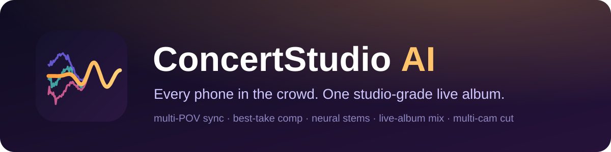

<p align="center"></p>

<p align="center">
  <b>Turn the phone videos a crowd posts of one song into a studio-grade live album and a synced multi-camera cut.</b>
</p>

<p align="center">
  <a href="#how-it-works">How it works</a> ·
  <a href="#measured-results">Measured results</a> ·
  <a href="#install">Install</a> ·
  <a href="#quickstart">Quickstart</a> ·
  <a href="#benchmark">Benchmark</a> ·
  <a href="#license-and-credit">License</a>
</p>

---

After a show, dozens of people post the same song from different spots in the crowd. Every clip is flawed in
its own way: a fan screaming next to the phone, auto-gain pumping, a clipped mic, a 32 kbps re-encode, a
pocket, a balcony echo. ConcertStudio AI lines all of them up to the millisecond, picks the best-sounding phone
for every moment, separates the band into stems with neural networks, and mixes them into one consistent,
radio-ready master. It then cuts the phones' video on the music's downbeats into one multi-camera edit, with
lip sync checked shot by shot.

It is built for the real thing: one song, 2 to 60 phones, partial and overlapping clips, duplicates and
re-uploads, and works with as few as one clip.

## What you get

| Output | Details |
|---|---|
| Live-album master | 24-bit WAV at 44.1 and 48 kHz, -14 LUFS, -1 dBTP; optional iZotope Ozone 12 master |
| Stems | vocals, guitar, bass, drums, keys, other, crowd (24-bit) |
| Curated clip list | duplicates and re-uploads merged, trash (other songs, talking, unusable audio) listed with reasons, cleaned WAVs |
| Multi-camera video | 1080x1920 H.264 MP4 cut between the real phones on downbeats and vocal entrances, muxed with each master; trim to any range; CMX 3600 EDL with real source timecode for Premiere/Resolve |
| Reports | per-stage JSON: take path, lag tracks, mix moves, per-shot sync offsets |

## How it works

Every V8 stage below is real signal processing and machine learning, measured on real payloads.

**1. Ingest and curate.** Every clip is decoded and probed. TikTok's 32 kbps HE-AACv2 copies (synthetic SBR
highs and parametric fake stereo) are detected so they never supply high frequencies or stereo. Re-uploads of
the same recording are grouped by coherence and only the best encode is kept.

**2. Temporal alignment (sub-millisecond, drift-aware).** Coarse placement cross-correlates log-band onset
novelty against a growing union of already-placed clips. Fine alignment runs GCC-PHAT on 8 s windows at 16 kHz;
a Theil-Sen fit of lag against time gives each phone's offset and its clock drift in ppm. A time-varying lag
track is then refined against each clip's best neighbours, and windows that do not agree (splices, talking, a
different song) are marked invalid and never used. Clips that share no audio with the rest (sparse payloads)
form separate *islands* instead of being thrown away.

**3. Crowd removal (ML).** A Mel-Band RoFormer crowd model runs on every phone, giving a clean music signal and
a per-moment crowd-to-music ratio.

**4. Best-take comp.** Every phone is scored on a 0.5 s grid by its coherence with the others, crowd ratio,
occlusion, clipping and level anomalies, *auto-gain pumping* (its fast level wobble against the consensus of
all phones), vocal-band coherence (a fan singing into the mic is incoherent with everyone else) and a perceptual
quality score from Meta's Audiobox Aesthetics model (ML). A Viterbi path with a switching cost and a minimum
dwell picks one phone at a time; phones are never averaged, which is what causes shimmer and comb filtering.
Highs above 7 kHz only come from full-band takes. A consensus loudness lock makes the render's dynamics follow
the median of all phones, removing pumping and switch swells. A second-best path supplies a real second
microphone for stereo.

**5. Stems (ML).** A three-model vocal ensemble (Mel-Band RoFormer Kim FT3, Big Beta 6X, becruily), a BS-RoFormer
six-stem split of the instrumental, and RoFormer de-reverb on the vocal, all via `audio-separator`.

**6. Mix and master.** A slow *tonal stabilizer* keeps each stem's and the bus's tone consistent across the song
even when the comp moves from a dark phone to a bright one. Stems are balanced vocals-first, accompaniment is
carved under the voice, two real phone positions form the stereo image, and synthetic plate and hall plus a
gentle glue compressor make it sound like a record rather than a phone. A true-peak limiter finishes at -14 LUFS.
An optional configured Ozone 12 chain (Windows) is included.

**7. Multi-camera director.** Beats, downbeats and vocal entrances come from the master and the vocal stem.
Each phone's video is mapped onto the master clock with its measured offset, drift and the audio/video offset of
its file. Shots cut on downbeats, preferring vocal entrances, only use footage whose audio was validated in step 2,
favour sharp, well-exposed, close angles, never repeat the previous camera and alternate close and wide. Each
shot is rendered frame-exact, then the clip's own audio is cross-correlated against the master to verify sync.

## Measured results

**Case study: one song, 82 phone posts (56 unique recordings after de-duplication).** Perceptual quality is
Audiobox Aesthetics PQ (higher is better; it agrees with listening tests on this material).

| Version | PQ (native) | PQ (Ozone) | Notes |
|---|---|---|---|
| V7 (per-bin fusion of all phones) | 5.69 | n/a | shimmer, warble |
| V8, 31 phones | 6.32 | 6.51 | best-take comp, neural stems |
| V8, 56 phones + pumping control | 6.69 | 6.81 | fast wobble of the comp 1.08 -> 0.74 dB |
| V8 + tonal stabilizer (current) | 6.73 | 6.84 | tone wander across the song 3.4 -> 2.6 dB; no 10 s window worse by 0.3 |

Multi-camera cut of the same song: 57 phones (16 letterboxed uploads detected and passed over), 78 shots over
the full 370 s with no gaps; measured sync of every shot against the master: median 0.8 ms, max 21 ms (one video
frame is 33 ms).

**Benchmark (simulated phones, 75 s excerpts, real crowd audio; see [Benchmark](#benchmark)).** Baseline is
the best raw phone *for each metric*, a deliberately hard comparison:

| case | phones | coverage: best phone -> output | tone error dB: best phone -> output | tone wander dB: best phone -> output | level wobble dB: best phone -> comp |
|---|---|---|---|---|---|
| acoustic_1 | 1 | 0.96 -> 0.97 | 7.8 -> 7.5 | 1.71 -> 1.62 | 2.66 -> 2.68 |
| acoustic_2ov | 2 | 0.78 -> 0.72 | 7.1 -> 6.9 | 1.01 -> 1.23 | 2.29 -> 2.33 |
| edm_2ov | 2 | 0.73 -> 0.76 | 11.3 -> 9.8 | 1.04 -> 1.93 | 1.85 -> 1.94 |
| indie_3ov | 3 | 0.73 -> 0.96 | 2.6 -> 6.1 | 0.88 -> 2.22 | 1.53 -> 2.13 |
| rock_1 | 1 | 1.00 -> 0.96 | 3.6 -> 2.3 | 0.78 -> 0.73 | 0.98 -> 1.12 |
| rock_2isl | 2 | 0.50 -> 0.88 | 4.8 -> 1.9 | 0.50 -> 0.88 | 0.79 -> 1.18 |
| rock_3ov | 3 | 0.79 -> 0.94 | 2.8 -> 1.9 | 0.27 -> 0.79 | 0.72 -> 1.40 |
| rock_5ov | 5 | 0.77 -> 0.93 | 2.6 -> 1.8 | 0.46 -> 0.83 | 0.67 -> 1.28 |

What it shows, honestly:

- **Coverage and tone are the big wins** on real band recordings (rock rows): the output covers 88-96% of the song
  where the best single phone had 50-79%, with 0.8-2.9 dB less tone error.
- **Tone wander and level wobble are not better than the single best phone** with only 1-5 phones: switching
  between phones costs some consistency, and with so few phones there is little consensus to correct pumping.
  The simulated crowd here (people singing a different song) also partly fools the crowd measure, so the comp
  sometimes keeps the phone next to the loudest fan. On the real 56-phone payload above, these improve.
- **indie_3ov**: a very dark production; the comp is closest to its tone (2.6 dB) but the generic mix targets
  brighten it. Use `tone_ref` when you have the studio version.
- **acoustic_2ov, edm_2ov**: the source tracks repeat bar-for-bar identically (a looped demo, a synthetic EDM loop),
  which makes both alignment and scoring ambiguous; treat these rows as a known limitation, not a result.

## Few clips, other genres

The pipeline does not assume a big payload or a particular style:

- **One clip** still gets crowd removal, neural stems, the tonal stabilizer and the live-album mix.
- **Stretches only one phone filmed are kept.** Nothing can confirm or contradict that phone's timing there, so its
  fitted alignment is trusted; stretches where phones exist but disagree are still rejected. (Before this, three
  staggered phones produced only 74% of the song; now 94%.)
- **Clips that never overlap become islands.** With few clips, repeated sections can fool onset matching (chorus 2
  looks like chorus 1), so the strongest coarse candidates are checked on the waveform (fine GCC-PHAT whose lags
  must line up with one offset and clock drift) and a clip that shares no waveform with the others starts its own
  island after a short gap. With 6+ clips, placements reinforce each other and the original coarse rule is kept;
  a clip that overlaps nobody there is almost always another song or talking, so it is listed as unplaced.
- **No singer, no guitars.** The vocals-first balance only applies in full when a voice is clearly present. In an
  instrumental, the "vocals" stem is usually a synth lead or residue: melodic stems then stay within 2 dB of the
  band's own balance, nothing is carved out for a voice, and the arrangement's dominant stem is never cut by more
  than 3 dB. Stems that are only separation residue are never boosted.
- **Unusual productions.** Stem tone targets are generic. If you have the studio recording,
  `--set tone_ref=studio.wav` gently matches the master's long-term tonal balance to it.
- **Letterboxed uploads** (landscape video posted inside a vertical frame) are detected; the director crops the
  black bars, fills the frame like any landscape clip, and scores the clip by its real resolution.

Quality still grows with the number of phones: more phones means more choice at every moment and a better
consensus for the loudness lock. See the [benchmark](#benchmark).

## Install

Requirements: Python 3.10+, FFmpeg on `PATH`, and a CUDA GPU for the neural stages (CPU works, slowly).
Plan on at least 16 GB of RAM for a 6-minute song with 50+ phones.

```bash
git clone https://github.com/Gavinboley/concert-studio-ai
cd concert-studio-ai
python -m venv .venv && source .venv/bin/activate
pip install -e ".[ml,quality,dev]"           # add ,ozone on Windows if you own iZotope Ozone 12
```

Model checkpoints are downloaded on first use by `audio-separator`. Set `CS_MODELS=~/models/concert_studio` to
share one model cache between projects.

## Quickstart

Put every clip of one song (MP4, MOV, M4A, MP3, WAV, ...) in a folder, then:

```bash
W=~/cs_work/my_song
python -m concert_studio.v8.run align   --src ~/clips/my_song --work $W      # temporal alignment, de-dup
python -m concert_studio.v8.run crowd   --work $W                           # crowd removal per phone (GPU)
python concert_studio/v8/quality.py     --work $W                           # perceptual take scores (GPU)
python -m concert_studio.v8.run comp    --work $W --name 1 \
       --set w_pq=12,w_ce=2,w_coh=2,w_pump=8,switch_cost=80,min_dwell_s=12
python -m concert_studio.v8.run stems   --work $W --name 1                  # neural stems (GPU)
python -m concert_studio.v8.run mix     --work $W --name 1 --out out --tag my_song
python -m concert_studio.v8.run publish --work $W --name 1 --out out --tag my_song   # job folder for video/UI
```

The master is `out/my_song_master_44k24.wav` (and `_48k24.wav`), stems are next to it. Mix settings can be
overridden with `--set name=value` (see `MixParams` in `concert_studio/v8/master.py`).

**Multi-camera video** (needs the clips' video files):

```bash
J=workspace_ui/<job>                                             # the folder printed by `publish`
python -m concert_studio.v8.video roster --work $W --name 1 --job $J
python -m concert_studio.v8.video export --job $J --audio native,ozone          # whole song
python -m concert_studio.v8.video export --job $J --start 30 --end 75           # trimmed cut
```

`--seed N` gives a different but equally valid cut; `--encoder h264_nvenc` uses the GPU encoder.

**Curating a messy download** (duplicates, other songs, talking): after `align`, `crowd`, `quality.py` and a
plan-only comp (`comp --name P --set plan_only=1`), `run curate --work $W --out <dir> --name P` writes
`MASTER_LIST.csv`, `TRASH_LIST.csv` and cleaned WAVs.

**Optional Ozone 12 master (Windows):** set `CS_OZONE_PYTHON` to a Windows Python with `pedalboard`, then
`%CS_OZONE_PYTHON% concert_studio\v8\ozone_master.py out\my_song_premaster_f32.wav out\my_song_ozone.wav`.

Run heavy stages one at a time. Running several separation jobs at once can exhaust RAM and take the whole
machine down.

## Benchmark

Real crowd footage has no clean reference, so claims need a controlled stand-in.
`concert_studio/v8/simulate.py` turns any studio track into a set of simulated phone clips of one performance:
venue reverb at a different distance per phone, a crowd bed and a screaming fan next to one phone, phone mic
response, auto-gain pumping, a clipping phone, clock drift, partial or non-overlapping coverage, and AAC encoding
(one phone at 32 kbps, mono, low-passed). The scorer compares the pipeline's master with the clean reference:

| Metric | Meaning |
|---|---|
| coverage | share of the song the output contains |
| tone_db | long-term 1/3-octave spectrum error against the studio original (muffled or harsh) |
| tone_wander_db | how much that tone error changes over time (morphing) |
| wobble_db | fast level error against the reference (pumping, switch swells); read at the comp stage, because the mix's intentional vocal riding and reverb would count as error against the original mix |
| unexplained_db | energy the dry reference cannot explain: crowd and noise, but also room and added reverb (diagnostic only) |

```bash
python -m concert_studio.v8.simulate make  --ref song.wav --out bench/rock_3 --n 3 --start 20 --dur 75 --seed 1
bash bench/run_bench.sh                       # full pipeline on every case in $BENCH_DIR, then scores
```

## Project layout

| Path | What it is |
|---|---|
| `concert_studio/v8/` | the current engine: `align`, `comp`, `mix`, `master`, `video`, `curate`, `quality`, `simulate`, `run` |
| `concert_studio/web.py`, `static/` | local web UI to browse jobs and A/B masters (`python -m concert_studio.cli serve`); its multi-cam panel is a legacy preview, render real cuts with `concert_studio.v8.video` |
| `concert_studio/*.py` (top level) | the earlier V1-V7 engine, kept for reference; superseded by `v8` |
| `tests/` | unit tests (`pytest -q`) |
| `bench/` | benchmark runner and scorer |

## Limitations

- It can only remaster what someone filmed. Gaps in coverage stay gaps (islands are separated by a short,
  faded silence).
- The mix aims at a typical modern studio balance. A deliberately dark or lo-fi production comes out brighter
  than its record unless you pass the studio recording with `--set tone_ref=studio.wav`.
- Material that repeats bit-for-bit (looped demos, shows played over identical backing tracks) can be placed a few
  bars off when clips do not share their true overlap.
- With very few phones there is little to choose from and no consensus to correct auto-gain pumping, so a single
  phone's pumping and crowd largely remain (they are reduced, not removed).
- Burned-in captions and watermarks in the videos are not removed.
- The crowd singing along is part of a live recording; it is reduced, not erased.
- You need the rights to the recordings and music you process and publish.

## License and credit

ConcertStudio AI is free for non-commercial use under the
[ConcertStudio AI Non-Commercial Attribution License](LICENSE). Commercial use (selling it, offering it as a
paid service, building it into a product, or monetized output) needs written permission from the author.

Credit is required in every use, including projects and videos made with it:

> Made with ConcertStudio AI by Gavin Boley - https://github.com/Gavinboley

Third-party models and tools (FFmpeg, PyTorch, audio-separator and its RoFormer checkpoints, librosa, Audiobox
Aesthetics, iZotope Ozone) keep their own licenses.
